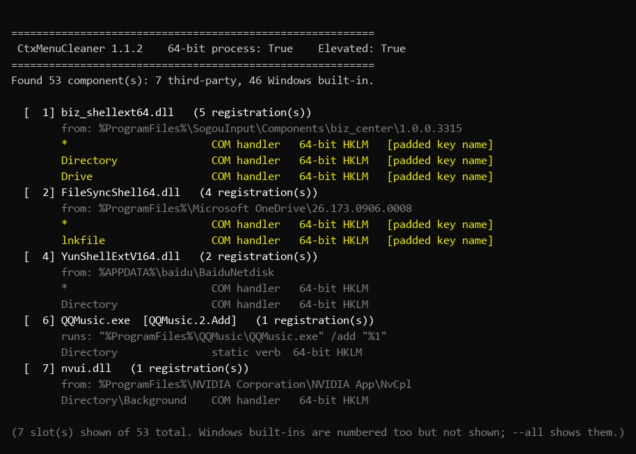
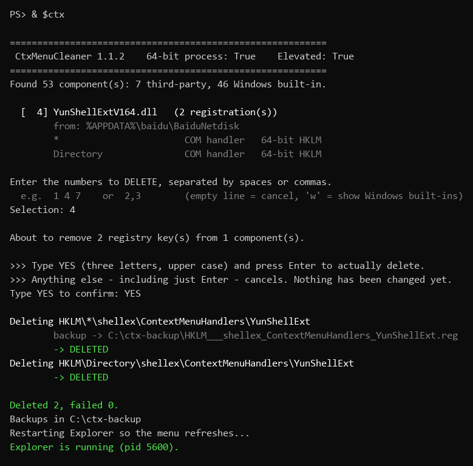

# windows-context-menu-cleanup

彻底清除 Windows 资源管理器右键菜单里的第三方软件项（百度网盘、迅雷、搜狗输入法、360 等）
——**先看清楚、再动手删、删完能回滚、绝不假成功**。

[English](./README.en.md) · [更新记录](./CHANGELOG.md) · [MIT 许可证](./LICENSE)

**当前版本 v1.1.3。** 提供两种用法：一个**原生可执行文件**（推荐，单文件、无需 PowerShell），
和一套**PowerShell 脚本**（无需编译，便于审计与二次开发）。

---

## 目录

- [1. 这个项目解决什么问题](#1-这个项目解决什么问题)
- [2. 主要功能](#2-主要功能)
- [3. 安装方法](#3-安装方法)
- [4. 使用方法](#4-使用方法)
- [5. 使用示例](#5-使用示例)
- [常见问题](#常见问题)
- [安全与回滚](#安全与回滚)
- [测试环境](#测试环境)

**急着用？** 跳到 [3 分钟上手](#3-分钟上手)。

---

## 1. 这个项目解决什么问题

你删了注册表键，`reg` 提示**「操作成功完成」**，但菜单**纹丝不动**。不是缓存问题，是三个原因。

### 1.1 键名被空格填充（最主要）

真实抓到的数据：

```
键名  : [    sgshellext]        length=14
字符码: 0020 0020 0020 0020 0073 0067 ...      ← 四个前导空格
```

可见名字是 `sgshellext`，键**实际叫** `"    sgshellext"`。所以这两条命令都会报成功、
**一个字节都没删**：

```powershell
Remove-Item '...\ContextMenuHandlers\sgshellext' -Force
reg delete "...\ContextMenuHandlers\sgshellext" /f
```

> **本项目不用固定键名**，只枚举容器 + 子串匹配。

### 1.2 注册了两套机制，你只删了一套

| 形态 | 位置 | 说明 |
|---|---|---|
| 静态动词 | `...\shell\<动词>` + `command` 子键 | 删掉该动词 |
| COM 扩展 | `...\shellex\ContextMenuHandlers\<名称>`，默认值是 CLSID | **通常真正画出菜单项的是它** |

百度网盘**两套都用了**（`YunShellExplorerCommand` + `YunShellExt`），只删前者毫无变化。

### 1.3 只删了一套注册表视图

32/64 位视图是**两套独立存储**，删一套另一套仍生效（实测：删掉 64 位后，同名键在 32 位
视图依然存在）。

PowerShell 5.1 还**无法在单进程内读两套视图**（`RegistryKey.OpenBaseKey` 在 5.1 不存在），
所以脚本要靠重启 32 位子进程补全；原生 exe 有这 API，一个进程搞定。

---

## 2. 主要功能

### 2.1 两个入口，按需选

| | 原生 `CtxMenuCleaner.exe` | PowerShell 脚本 |
|---|---|---|
| 是否需编译 | 需一条命令（用 Windows 自带编译器） | 不需要 |
| 依赖 PowerShell | **完全不依赖** | 需系统自带 5.1 |
| 易审计 | 需读 C# 源码 | 纯文本，打开即看 |
| 适用 | 日常使用、批量清理 | 审查代码、二次开发 |

**能力一致**：枚举匹配（不用固定键名）、覆盖两套视图、先备份后删除、删除后回读验证。

### 2.2 五个脚本

| 脚本 | 作用 |
|---|---|
| **`manage-context-menu.ps1`** | 列出全部组件（按 DLL/exe 分组编号，标注第三方/内置），按编号删掉该组件的**全部注册项** |
| **`remove-vendor-context-menu.ps1`** | 按 `vendors.json` 特征做**可重复批量删除**，可追加自己的特征 |
| **`enumerate-context-menu.ps1`** | **只读审计**：真实键名、字符码、CLSID 对应的 DLL。排查"这菜单项是谁"时用 |
| **`validate.ps1`** | **自检**：JSON 加载、`\uXXXX` 解码、语法、纯 ASCII，并跑一次 dry-run。不需管理员 |
| `_list-view.ps1` | 内部辅助（枚举 32 位视图），不必手工运行 |

### 2.3 两条额外保证

- **删除后回读验证，绝不吞错误** —— 失败会明确报 `-> FAILED: ...`。这是项目的起点：
  最初就是因为轻信 `reg` 的退出码而假报成功过一次。
- **默认安全** —— Windows 内置项被标注且**默认不选中**。凡不能明确归因第三方的
  （裸模块名 `@shell32.dll,-8506`、通用动词 `open`/`runas`、未解析的 CLSID）一律归为内置；
  只有 `-SelectWin` 才会碰它们。

### 2.4 它**不**做

- **不卸载**软件、不删文件、不改文件关联——只删右键菜单的**注册项**。
- **不能阻止**软件下次启动时重新注册，见 [让删除不复活](#让删除不复活)。
- **不覆盖**资源管理器工具栏、"发送到"目录、IE 的 `MenuExt`。

---

## 3. 安装方法

无需安装器，除 Windows 本身外无依赖。

| 项目 | 要求 |
|---|---|
| 操作系统 | Windows 10 / 11 —— 实测于 Windows 10 22H2（build 19045） |
| PowerShell | 5.1（自带）**已实测**；7+ 设计上可用但**未实测** |
| .NET Framework | 4.x（Win10 自带），仅编译 exe 时需要 |
| 管理员 | 删除时需要；`--list` / `-ListOnly` / `--dry-run` / `-DryRun` / `--selftest` / `validate.ps1` 不需要 |

获取文件：

```powershell
git clone https://github.com/simonwen-oss/windows-context-menu-cleanup.git
cd windows-context-menu-cleanup
```

或从 [Releases](https://github.com/simonwen-oss/windows-context-menu-cleanup/releases) 下载 ZIP。

> 报 `禁止运行脚本` 时加 `-ExecutionPolicy Bypass`，例如
> `powershell -ExecutionPolicy Bypass -File .\scripts\validate.ps1`。

**先自检**（只读、不需管理员，预期以 `ALL CHECKS PASSED` 结尾）：

```powershell
powershell -ExecutionPolicy Bypass -File .\scripts\validate.ps1
```

**编译 exe**（可选）：

```powershell
.\src\build.ps1 -Test        # 产物：%LOCALAPPDATA%\CtxMenuCleaner\CtxMenuCleaner.exe
```

> ⚠️ 默认输出到 `%LOCALAPPDATA%` 是有意为之，**别改到含中文或 OneDrive 同步的目录**——
> 从那种路径启动的 exe 完全无法写注册表。见 [常见问题](#从中文onedrive-目录运行-exe删除全部失败)。

---

## 4. 使用方法

### 3 分钟上手

```powershell
# ---------- 原生 exe（推荐）----------
$ctx = "$env:LOCALAPPDATA\CtxMenuCleaner\CtxMenuCleaner.exe"
& $ctx --list                 # 1. 看清单（不需管理员，不删任何东西）
& $ctx --select 4 --dry-run   # 2. 试运行，确认它要删什么
& $ctx --select 4 --yes       # 3. 真删（管理员终端）。--yes 让它不读键盘

# ---------- PowerShell 脚本 ----------
.\scripts\manage-context-menu.ps1 -ListOnly      # 1. 看清单（不需管理员）
.\scripts\manage-context-menu.ps1 -Select 4      # 2. 真删（管理员终端）
.\scripts\remove-vendor-context-menu.ps1 -DryRun # 试运行：按特征批量删除会命中什么
```

**编号**：第三方组件从 `1` 起，Windows 内置项排其后。编号取决于枚举顺序，**每次运行可能变化**
——先看清再删。`manage-context-menu.ps1` 没有 dry-run 参数，看清单用 `-ListOnly`。

### 界面预览

**`--list` 看清有什么**（不需要管理员，不改变任何东西）：



标黄的三行是**键名被空格填充**的项——这类项用固定键名删不掉，是本项目存在的主要原因。

**交互式删除，注意那个 `YES`**：



输入编号后还要输入三个大写字母 `YES` 才会真正删除。加 `--yes` 可跳过（整条命令就不读键盘）。

### 参数在哪看

- **exe**：直接运行 `CtxMenuCleaner.exe --help`，全部参数分 **Options / Diagnostics / Misc** 三组列出。
- **脚本**：本文档下方各节按用途给出；完整中文对照见
  [`references/exe.md`](./references/exe.md) 与各脚本头部注释。

配置在 [`scripts/vendors.json`](./scripts/vendors.json)（7 条厂商、25 个特征）。中文关键词要写成
`\uXXXX` 转义——5.1 的 `ConvertFrom-Json` 不会解码它们，脚本自己解。

`enumerate-context-menu.ps1` 无参数，直接运行；只读，读 64 位视图。

### ⚠️ 交互模式：那个 `YES`

直接运行 exe、且不带 `--list` / `--select` 时会进入交互模式：先让你在 `Selection:` 输入编号，
**再要求你输入三个大写字母 `YES`** 才真正删除。输入其它内容（包括直接回车）都只是取消。

**这就是最容易踩的坑**——有人在这里输入了下一条命令，被当成取消，看起来就像"输入 4 没反应"。
不想管它就加 `--yes`。完整输出见[示例 D](#示例-d--交互式删除注意那个-yes)。

### 关于重启 explorer

删除成功后会自动重启 explorer 让菜单刷新，**任务栏和桌面图标会消失一下再回来**，这是正常的。
用 `-NoRestart` / `--no-restart` 可跳过：

```powershell
Stop-Process -Name explorer -Force; Start-Sleep 2; Start-Process explorer.exe
```

### ⚠️ `-SelectWin` 警告

它会选中 Windows 自己的 shell 扩展（"打开方式""发送到""固定到开始屏幕"、共享等），
**可能弄坏资源管理器**。仅为高级排障存在，请优先用 `-Select` 指定编号。
（exe 的 `--all` 只是**列出**内置项，不会选中，安全。）

---

## 5. 使用示例

### 示例 A —— 先看清菜单里有什么（安全，不需管理员）

```powershell
PS> & $ctx --list

 CtxMenuCleaner 1.1.3    64-bit process: True    Elevated: False
Found 52 component(s): 7 third-party, 45 Windows built-in.

  [  1] FileSyncShell64.dll   (4 registration(s))
        from: C:\Program Files\Microsoft OneDrive\26.173.0906.0008
        *                       COM handler   64-bit HKLM   [padded key name]
        Directory               COM handler   64-bit HKLM   [padded key name]
        ...
  [  4] YunShellExtV164.dll   (2 registration(s))
        from: C:\Users\<用户>\AppData\Roaming\baidu\BaiduNetdisk
        *                       COM handler   64-bit HKLM
        Directory               COM handler   64-bit HKLM

(7 slot(s) shown of 52 total. Windows built-ins are numbered too but not shown; --all shows them.)
```

注意 `[padded key name]` —— 反删除手法**被识别并标注**的样子。

### 示例 B —— 试运行，确认真要删什么

```powershell
PS> & $ctx --select 4 --dry-run
About to remove 2 registry key(s) from 1 component(s).
Dry run: nothing was deleted.
```

### 示例 C —— 真删（一步，无交互）

```powershell
# 管理员终端
PS> & $ctx --select 4 --yes

Deleting HKLM\*\shellex\ContextMenuHandlers\YunShellExt
        backup -> C:\ctx-backup\HKLM___shellex_ContextMenuHandlers_YunShellExt.reg
        -> DELETED
Deleting HKLM\Directory\shellex\ContextMenuHandlers\YunShellExt
        backup -> C:\ctx-backup\HKLM_Directory_shellex_ContextMenuHandlers_YunShellExt.reg
        -> DELETED

Deleted 2, failed 0.   Backups in C:\ctx-backup
Restarting Explorer so the menu refreshes...
Explorer is running (pid 5600).
```

### 示例 D —— 交互式删除（注意那个 `YES`）

```powershell
PS> & $ctx
...
Selection: 4

About to remove 2 registry key(s) from 1 component(s).

>>> Type YES (three letters, upper case) and press Enter to actually delete.
>>> Anything else - including just Enter - cancels. Nothing has been changed yet.
Type YES to confirm: YES          ← 必须是大写 YES
```

### 示例 E —— PowerShell 脚本按特征批量删除

```powershell
PS> .\scripts\remove-vendor-context-menu.ps1 -DryRun
Loaded 24 patterns from ...\scripts\vendors.json

MATCH  HKLM /reg:64 *\shellex\ContextMenuHandlers
       key name : [    sgshellext]  length=14   <== PADDED NAME
       charcodes: 0020 0020 0020 0020 0073 0067 0073 0068 0065 006C 006C 0065 0078 0074
...
=== 64-bit view: matched 8, deleted 0, failed 0 (dry run) ===
```

去掉 `-DryRun` 并以管理员运行，每条命中项会变成 `-> DELETED` 或 `-> FAILED (exit N): ...`

### 示例 F —— 排查"这菜单项到底是谁"

```powershell
PS> .\scripts\enumerate-context-menu.ps1 | Select-String 'PADDED' -Context 3,0
```

它给出真实键名、字符码、CLSID 对应的 DLL。拿到键名子串后加进
[`scripts/vendors.json`](./scripts/vendors.json) 的 `patterns`，再 `-DryRun` → 删除：

```json
{ "vendor": "某软件", "patterns": ["SomeAppShellExt"] }
```

### 示例 G —— 回滚

```powershell
reg import ".\context-menu-backup-<时间戳>\HKLM_Directory_shellex_ContextMenuHandlers__FileSyncEx.reg"
Stop-Process -Name explorer -Force; Start-Sleep 2; Start-Process explorer.exe
```

### 让删除不复活

软件下次启动或升级时通常会把键**写回来**。按推荐程度：

1. **在软件自己的设置里关掉集成开关** —— 最干净，能扛住升级
   （搜狗：属性设置 → 高级 → 右键菜单；百度网盘、迅雷类似）。
2. **给具体键设 Deny 写入权限**（`regini` 或改 ACL）—— 更霸道；安装程序重建键并带来新 ACL 时需重做。
3. **升级后重跑本脚本。**

## 常见问题

### 从中文/OneDrive 目录运行 exe，删除全部失败

症状：`--list` 正常，但每次删除都报
`-> FAILED: OpenSubKey(writable) ... SecurityException HR=0x8013150A`。
不是权限配置问题，而是**启动位置**问题（实测同一份二进制）：

| exe 启动自 | 能否写 HKCU |
|---|---|
| `C:\Users\<用户>\OneDrive\文档\...`（中文 + OneDrive） | ❌ 完全不能 |
| `C:\Users\<用户>\AppData\Local\Temp\...` | ✅ 正常 |
| `C:\Users\<用户>\AppData\Local\CtxMenuCleaner\` | ✅ 正常 |

**解决**：`--selftest` 一条命令确认，然后把 exe 放到纯 ASCII 路径（默认构建位置就是）。
PowerShell 脚本**不受影响**（由 `powershell.exe` 执行，不是从该路径启动的独立进程）。

### 删除报成功但菜单项还在

看 `--list` 那行有无 `[padded key name]`，以及你是否**同时**删掉静态动词与 COM 扩展
（见 [1.2](#12-注册了两套机制你只删了一套)）；再确认两套视图都覆盖（exe 天然覆盖，脚本会自动补 32 位）。

### 交互模式里输入编号后没反应

程序在等你在 `Type YES to confirm:` 输入**大写 `YES`**；输入其它内容会取消（现在会明确告诉你
收到了什么）。用 `--yes` 彻底跳过。

### 中文乱码

5.1 控制台按 ANSI 代码页（本机 936）解码子进程输出。脚本源码保持纯 ASCII 就是为了避开这类问题。

### 更多坑

| 现象 | 原因 |
|---|---|
| `MethodNotFound: ... OpenBaseKey` | 该 API 是 .NET Core / PS 7 专属，你在用 5.1。查 `$PSVersionTable.PSEdition` |
| `Access is denied` | 键在 `HKLM` 下，进程没提权 |
| 64 位菜单项没了、32 位还在（或反之） | 另一套注册表视图没处理 |
| `New-Item` 建出名字被拼接的怪键 | `*` 对注册表提供程序是通配符。读用 `-LiteralPath`，删用 `reg.exe` |
| 桌面和任务栏消失 | 你杀掉了 explorer，`Start-Process explorer.exe` 恢复 |

- 完整排查：[references/troubleshooting.md](./references/troubleshooting.md)
- **开发中判断错的地方**：[references/lessons-learned.md](./references/lessons-learned.md)
- 实测厂商注册点与真实键名：[references/field-notes.md](./references/field-notes.md)
- exe 完整说明：[references/exe.md](./references/exe.md)

---

## 安全与回滚

**备份**：删除前每个键都用 `reg.exe export` 导出成 `.reg`（UTF-16LE，正是 `reg import` 要的格式）：

```
context-menu-backup-20261006-221917\
    HKLM___shellex_ContextMenuHandlers_YunShellExt.reg
```

**恢复**：

```powershell
reg import "context-menu-backup-20261006-221917\HKLM___shellex_ContextMenuHandlers_YunShellExt.reg"
Stop-Process -Name explorer -Force; Start-Sleep 2; Start-Process explorer.exe
```

**注册表风险**：本项目会修改注册表，存在固有风险——**运行前请审阅脚本与备份产物，并先在非关键
机器上测试**。作者不对使用造成的损害承担责任，详见 [LICENSE](./LICENSE)。

**作为 DSH 技能**：本仓库也是合法的 [DeepSeek Harness](https://github.com/deepseek-ai/deepseek-harness)
技能。整个目录复制到 `$DSH_HOME/skills/`（通常 `~/.dsh/skills/`），保持 `SKILL.md` 在根目录：

```powershell
Copy-Item . "$env:USERPROFILE\.dsh\skills\windows-context-menu-cleanup" -Recurse
```

---

## 测试环境

所有验证都在下面这台机器上完成。**标注"未实测"的，请勿视作可用。**

| 项目 | 值 |
|---|---|
| 验证日期 | 2026-10-06 |
| 操作系统 | Windows 10 专业版 22H2，build 10.0.19045.6466（64 位） |
| 语言 / 区域 | 中文（简体）· `zh-CN` |
| **ANSI 代码页** | **936（GBK）** —— 脚本必须纯 ASCII 的原因 |
| **Windows PowerShell** | 5.1.19041.6456（`Desktop`）**← 全部测试在此完成** |
| .NET / csc.exe | .NET FW 4.8.09037 / csc 4.8.9232.0（编译 exe 用） |
| 硬件 | i5-12600KF（10 核 16 线程）· 31.8 GB |
| **PowerShell 7+** | **未安装、未测试** |

**实测通过**

- 8 个脚本在 5.1 下语法解析通过，源码 **0 个非 ASCII 字节**
- `validate.ps1` 全部通过（含 `\u641c\u72d7` → `641C 72D7` 解码断言）
- 带 **4 个前导空格**的键名能被枚举、匹配并**真实删除**；中文键名 `百度网盘` 正确匹配
- `reg.exe export` 的备份可被 `reg import` 使用
- exe：单进程读到两套视图（7-Zip 同时以 `7-zip.dll`/`7-zip32.dll` 出现）、标注填充键名、
  `--dry-run` 不删任何东西、`--selftest` 正确报告写权限
- exe：控制台配色生效，且**重定向输出时自动降级为纯文本**（`--no-color` 亦可强制）
- exe：**在真实管理员终端完整跑通交互流程**（编号解析 → `YES` → 删 2 个 HKLM 键 → 备份 → 重启 explorer）
- 原始目标（搜狗 8 项 + 百度 8 项）清理后残留为 **0**

**明确未实测**

- PowerShell 7+（`pwsh`）· Windows 11 · 非中文系统区域 · 除 19045.6466 外的版本

---

## 来源与致谢

这里每个坑都是在真实机器上清掉百度网盘、迅雷、搜狗输入法时**实际踩到的**——包括第一次
「报成功但零字节删除」、脚本因 `OpenBaseKey` 在第 90 行直接崩溃、杀掉 explorer 后留下一片空桌面。

写这份文档就是为了让你不必再踩一遍。开发者建议先读
[references/lessons-learned.md](./references/lessons-learned.md)。
